# Commit

## Overview

Structured git commit workflow that enforces project-specific requirements (version bumps) and prevents common mistakes (missing files, wrong scope, duplicate commits).

## When to Use

- User says "commit", "提交", or equivalent
- After completing a logical unit of work
- Before switching branches or creating PR
- Invoked as the `/commit` slash command in pi

**When NOT to use:**
- Mid-implementation (incomplete feature)

## Commit Granularity

- One logical change per commit; all tests passing at each commit
- Batch all edits for a single feature/fix into one commit — never commit after each individual file edit
- Rust: `cargo clippy` cycles within a single logical change are **preparation steps**, not separate commits (formatting runs once, right before staging — see step 6). Commit only after the full logical change is complete and verified.

## Workflow

```dot
digraph commit_flow {
    "User requests commit" [shape=doublecircle];
    "Run git status/diff/log in parallel" [shape=box];
    "Check unpushed commits" [shape=box];
    "Should squash?" [shape=diamond];
    "Squash first" [shape=box];
    "Check project requirements" [shape=box];
    "Missing version bump?" [shape=diamond];
    "Bump version + update lock" [shape=box];
    "Has instruction file?" [shape=diamond];
    "Check instruction file consistency" [shape=box];
    "Inconsistent?" [shape=diamond];
    "Draft instruction-file updates" [shape=box];
    "User confirms update?" [shape=diamond];
    "Update instruction file + stage" [shape=box];
    "Check comment compliance" [shape=box];
    "Comment violations found?" [shape=diamond];
    "Draft comment fixes" [shape=box];
    "User confirms comment fix?" [shape=diamond];
    "Apply comment fixes + restage" [shape=box];
    "Analyze change type" [shape=box];
    "Draft commit message" [shape=box];
    "Stage files + commit" [shape=box];
    "Show commit report" [shape=box];
    "Done" [shape=doublecircle];

    "User requests commit" -> "Run git status/diff/log in parallel";
    "Run git status/diff/log in parallel" -> "Check unpushed commits";
    "Check unpushed commits" -> "Should squash?";
    "Should squash?" -> "Squash first" [label="yes"];
    "Should squash?" -> "Check project requirements" [label="no"];
    "Squash first" -> "Check project requirements";
    "Check project requirements" -> "Missing version bump?";
    "Missing version bump?" -> "Bump version + update lock" [label="yes"];
    "Missing version bump?" -> "Has instruction file?" [label="no"];
    "Bump version + update lock" -> "Has instruction file?";
    "Has instruction file?" -> "Check instruction file consistency" [label="yes"];
    "Has instruction file?" -> "Check comment compliance" [label="no"];
    "Check instruction file consistency" -> "Inconsistent?";
    "Inconsistent?" -> "Draft instruction-file updates" [label="yes"];
    "Inconsistent?" -> "Check comment compliance" [label="no"];
    "Draft instruction-file updates" -> "User confirms update?";
    "User confirms update?" -> "Update instruction file + stage" [label="yes"];
    "User confirms update?" -> "Check comment compliance" [label="no, manual"];
    "Update instruction file + stage" -> "Check comment compliance";
    "Check comment compliance" -> "Comment violations found?";
    "Comment violations found?" -> "Draft comment fixes" [label="yes"];
    "Comment violations found?" -> "Analyze change type" [label="no"];
    "Draft comment fixes" -> "User confirms comment fix?";
    "User confirms comment fix?" -> "Apply comment fixes + restage" [label="yes"];
    "User confirms comment fix?" -> "Analyze change type" [label="no, manual"];
    "Apply comment fixes + restage" -> "Analyze change type";
    "Analyze change type" -> "Draft commit message";
    "Draft commit message" -> "Stage files + commit";
    "Stage files + commit" -> "Show commit report";
    "Show commit report" -> "Done";
}
```



## Step-by-Step

### 1. Gather Context (parallel)

```bash
git status
git diff
git log --oneline -10
```

### 2. Check Unpushed Commits

```bash
git log @{u}..HEAD || git log origin/master..HEAD || git log origin/main..HEAD
```

If unpushed commits exist and belong to same logical change → squash before new commit.

### 3. Check Project Requirements

**Common patterns:**
- Version bump required? (check the project's instruction file `AGENTS.md`, plus `Cargo.toml`, `package.json`, `pyproject.toml`)
- Lock file must be included? (`Cargo.lock`, `package-lock.json`, `uv.lock`)

### 3.5. Project Instruction File Consistency Check

**If the project has an instruction file (`AGENTS.md`) at repo root:**

1. Read current instruction file content
2. Analyze staged changes (from `git diff --cached`):
   - Look for public interface changes: new/removed/modified functions, classes, types, exports
   - Look for behavior changes: new features, removed features, changed logic
   - Look for architecture changes: new dependencies, service integrations, data flow changes
3. Compare instruction file description against staged changes:
   - Does it describe the interfaces/features being added/removed?
   - Does it reflect the current architecture after these changes?
   - Are there new public APIs that it doesn't mention?
   - Are there removed features that it still describes?

**If inconsistency detected:**
- Show specific examples of what's inconsistent (e.g., "instruction file says vector model loads locally, but code now calls external service")
- Draft suggested instruction-file updates to match the code changes
- Ask user: "项目指令文件需要更新。我已经起草了建议的修改，要我直接更新吗？"
- If user confirms: update the instruction file, stage it, continue commit
- If user declines: explain they should update the instruction file manually before committing

**If consistent or no instruction file exists:**
- Continue to next step silently

**Bypass:**
- If commit message contains `[skip-instruction-file]` tag, skip this check entirely

### 3.6 Comment Check

**Review comments in and around the diff against the project comment policy (the Comments and 吴凯歌 sections of `~/.pi/AGENTS.md`):**

Read the diff with `git diff --cached -U10` for this step. The default 3 lines of context routinely hides the comment sitting just above a changed function — which is exactly what the Stale rule has to see.

- Restates implementation: would refactoring the adjacent code force this comment to change? Yes → it describes the implementation, not a constraint outside it → flag, suggest removal
- Too long: WHY comment exceeds ~80 chars or is a compound sentence rather than one short clause → flag, suggest tightening
- Stale: code changed in this diff but an adjacent unchanged comment still describes the old behavior → flag, suggest fixing or deleting
- Wrong language: code comment not in English, unless the project instruction file requires Chinese → flag, suggest translation

Doc comments (`///`, `//!`, `/** */`, docstrings) on public API are interface contract, not commentary — out of scope for this check. A rustdoc with `# Examples` and a doctest is legitimately long; do not flag it for length.

**If violations found:**
- List each as `file:line — rule violated`
- Ask user once, batched: "发现 N 处注释不符合规范，要我直接精简/翻译/删除吗？"
- If confirmed: edit the flagged lines, re-stage affected files
- If declined: proceed, note the skipped violations in the commit report

**If clean:** continue to next step silently.

**Bypass:**
- If commit message contains `[skip-comments]` tag, skip this check entirely

### 4. Analyze Change Type

Map changes to commit type:
- `feat`: new feature
- `fix`: bug fix
- `refactor`: code restructure, no behavior change
- `perf`: performance improvement
- `test`: test additions/changes
- `docs`: documentation only
- `chore`: maintenance (deps, config, release)
- `style`: formatting, whitespace
- `build`: build system changes
- `ci`: CI/CD changes

### 5. Draft Commit Message

Format: `<type>[optional scope]: <imperative summary>` (max 72 chars)

**Good:**
- `feat: add rate limiting to auth endpoints`
- `fix(parser): handle empty input without panic`
- `chore(release): bump version to v1.2.0`

**Bad:**
- `updated stuff` (vague)
- `Fixed bug` (not imperative, no context)
- `feat: added new feature for handling user authentication with JWT tokens and refresh token rotation` (too long)

Add body (separated by blank line) when WHY isn't obvious from diff.

### 6. Execute Commit

Format first, then stage the specific files and commit. No hook formats anything, so run the project's formatter yourself (Rust: `cargo fmt`; otherwise the one the instruction file or project config names) before `git add` — staging after formatting is what keeps the committed content and the working tree identical.

```bash
cargo fmt   # or the project's formatter
git add <specific files> [<lock files changed by the version bump>]
git commit -m "$(cat <<'EOF'
<commit message>

<Co-Authored-By trailer — use the one the current harness specifies; never hardcode a model name here>
EOF
)"
```

A version bump rewrites lock files (`Cargo.lock`, `uv.lock`, ...); after `git add`, run `git diff --name-only` and include every changed lock file — failing to do so leaves a dirty working tree after commit. Never run the formatter after `git add`: it rewrites the working tree but not the index, so the commit holds the unformatted version and the formatting is left behind as a dirty diff.

### 7. Show Commit Report

After successful commit, display a structured report:

```
✓ 提交完成

提交信息：
  <type>(<scope>): <summary>

已提交文件：
  - path/to/file1.rs
  - path/to/file2.rs
  - Cargo.toml (v0.1.5 → v0.1.6)
  - Cargo.lock

提交哈希：<short-hash>
```

**Report must include:**
- Commit message (full, including body if present)
- List of committed files with any special notes (version bumps, lock files)
- Commit hash for reference

## Branches

- Naming: `feat/description`, `fix/description`, `chore/description`
- Rebase feature branches onto main before merging; keep history linear
- Never force-push to main; force-push to personal feature branches is fine

## Common Mistakes

| Mistake | Fix |
|---------|-----|
| Commit without checking unpushed commits | Always check `git log @{u}..HEAD` first |
| Forget version bump | Check project instruction file `AGENTS.md` for requirements |
| Commit unrelated changes | Explicitly list files to stage, not `git add .` |
| Version bump updated lock file but wasn't staged | After bumping, run `git diff --name-only` and include any changed lock files in `git add` |
| Vague commit message | Use conventional commits format with clear summary |
| Missing commit report | Always show structured report after commit |
| Instruction file out of sync with code | Check its consistency before commit (Step 3.5), update if needed |
| Comments restate implementation, run long, went stale, or wrong language | Run Comment Check (Step 3.6) before drafting commit message |

## Red Flags

- "I'll commit everything in working tree" → Check if all changes belong together
- "Skip version bump this time" → Project requirements are not optional
- "Commit message: WIP" → Not a logical unit, don't commit yet
- "I'll run tests after committing" → Commit skill runs only on completed work; tests must pass first
- "Let me ask user to confirm first" → Commit skill executes directly, no confirmation needed
- "I'll run checks now" (after version bump check) → instruction file consistency check (Step 3.5) comes BEFORE committing; do not skip it when the file exists
