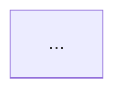

# Feature Analysis — 功能实现解析

把一个"我知道它能跑,但不知道它怎么跑"的功能,拆成一份可验证、可跳转、能直接拿去做下一步改动的说明书。

这个 skill 的典型场景是 vibe coding 之后的失控感:代码是生成出来的,能用,但骨架、数据结构、调用链全在黑箱里。解药不是把代码从头读一遍,而是**沿着一条主链路做定向追踪**,并把每个结论都钉在具体的 `文件:行号` 上。

## 三条铁律

**1. 只写读到的代码。** 每个结构性结论必须能指向 `path/to/file.py:120`。没读过的地方不猜。LLM 在这类任务上最大的失败模式是"生成一份听起来很合理的架构描述",而它和真实代码只有七分像 —— 这比不解释更有害,因为用户会基于它做改动。

**2. 已验证和推测必须分开标注。** 报告里凡是没有直接证据的判断,用 `(推测)` 明确标出,并在最后的「未验证」章节汇总。宁可说"这段我没追到",也不要填一个平滑的假答案。

**3. 一次只解析一个功能。** 用户说"帮我看看这个项目",要先收敛到一个具体的用户可感知的行为(一个接口、一个按钮、一个定时任务)。范围失控会直接导致质量崩塌。

## 工作流

### Phase 0 — 锁定目标与深度

先确认两件事,不确定就问,但只问一轮:

- **解析对象**:哪个功能?最好能描述成一句"用户做了 X,系统就 Y"。如果用户只给了模块名或文件名,反问它对应哪个用户行为。
- **深度**:
  - `速览` — 只要骨架:入口 + 主链路 + 核心数据结构。适合快速上手。
  - `完整`(默认)— 全部章节,包含异常路径、副作用、技术债。
  - `聚焦` — 用户只关心某一维(比如"我只想搞清楚数据结构")。那就把该章节做深,其余压成一段。

如果代码库很大,先跑一遍目录结构(`tree -L 2 -d` 或 `ls`)建立地形感,不要一上来就 grep。

### Phase 1 — 定位入口

入口是整条链路的锚点。找不到入口就没法追踪,所以这一步值得多花几次搜索。

搜索阶梯(从最可靠到最模糊,依次尝试):

1. **用户可见字符串** — 按钮文案、错误提示、URL 路径、CLI 子命令名。这些字符串在代码里几乎一定是字面量,`rg -n "导出报表"` 往往一击命中。
2. **路由/注册表** — 框架的路由声明处。见 `references/entry-points.md`,里面按框架列了具体的搜索式。
3. **数据落点反查** — 知道结果写进了哪张表/哪个字段,就 grep 表名或字段名,找到写入方,再向上回溯。
4. **测试文件** — `tests/` 里同名的测试往往直接调用了入口函数,而且顺带给出了输入输出的真实形状。这是最被低估的捷径。
5. **git 历史** — `git log --oneline --grep "关键词"` 或 `git log -S "函数名"` 找到引入这个功能的那次提交,`git show` 一次性看到全貌。

找到入口后,先确认**入口不止一个**:同一个功能常常有 HTTP 接口 + 定时任务 + 管理后台三条入口,漏掉任何一条,后面的"改动指引"就是错的。

### Phase 2 — 追踪主链路

从入口开始,深度优先地跟调用链。每跟一步记录:`文件:行号`、函数名、这一步在语义上做了什么(不是它的代码写了什么)。

实操要点:

- **读窄不读宽。** 用行号区间读函数体,不要整文件塞进上下文。上下文预算要留给追踪深度。
- **在语义边界停下。** 跟到框架内部、标准库、第三方 SDK 就停,记成一个黑箱节点即可。判断标准:这一层是不是用户可能会去改的代码?不是就不进去。
- **分支先记后追。** 遇到 if/早返回/异常分支,先在链路上标一个记号继续走 happy path,等主链路通了再回头补 Phase 5。
- **链路超过 15 步就分层。** 折叠成 "阶段 A(3 步)→ 阶段 B(5 步)",细节下沉到子列表。人读不了 30 步的平铺清单。

### Phase 3 — 采集数据结构

沿途每碰到一个类型定义、schema、表结构、字典字面量,都记下来。重点关注:

- **定义位置** 和 **字段中真正被用到的那几个**(生成的代码常有大量死字段)。
- **同一份数据的形态链**。这是 vibe coding 最容易出问题的地方:请求体 → DTO → ORM 模型 → 领域对象 → 响应模型,五个类描述同一个东西,字段名还对不齐。把这条变换链画出来,通常一眼就能看出哪里有冗余或字段丢失。
- **谁负责转换**。`from_orm` / `to_dict` / `serde` impl / mapper 函数在哪。
- **可选性与默认值**。哪些字段可能是 `None`/`undefined`,这决定了下游的坑在哪。

### Phase 4 — 数据流

把 Phase 2 和 Phase 3 合起来回答一个问题:**一份数据从哪来,经历了什么变形,最后落到哪去。**

至少覆盖:输入来源 → 校验 → 变换 → 持久化/外发 → 返回给调用方的东西。

### Phase 5 — 状态、副作用与异常路径

这一章决定了用户改代码时会不会踩雷:

- **外部依赖**:数据库(具体到表和关键索引)、缓存(具体到 key 格式和 TTL)、消息队列、第三方 API、文件系统。
- **全局/共享状态**:模块级单例、连接池、全局配置、进程内缓存。
- **并发与事务**:事务边界在哪?有没有锁?异步任务和主流程的时序关系?
- **异常路径**:错误怎么冒泡?有没有重试?失败后系统处于什么状态(有没有写了一半的脏数据)?
- **幂等性**:同一个请求重放两次会怎样?

读不出来的就标 `(未验证)`,不要脑补。

### Phase 6 — 输出报告

按下面的模板输出。`references/example-report.md` 有一份填好的完整示例,写之前扫一眼可以校准粒度。

如果当前环境能写文件,**默认把报告存成 `docs/<feature>.md`**（不放进 `docs/analysis/` 子目录）并告诉用户路径。理由值得说给用户听:这份文档下次可以直接喂给 AI 当上下文,vibe coding 的失控感很大程度上来自每次对话都从零开始。

## 报告模板

```markdown
# <功能名> 实现解析
> 代码版本:<git commit 或日期> | 深度:速览/完整/聚焦

## 一句话
<用户做了什么 → 系统做了什么 → 产生了什么结果,一句话>

## 1. 骨架
| 层 | 职责 | 关键文件 |
|---|---|---|
| ... | ... | `path/to/x.py` |

## 2. 入口
| 类型 | 触发方式 | 位置 |
|---|---|---|
| HTTP | `POST /api/v1/xxx` | `api/routes.py:42` |
| 定时 | 每天 03:00 | `jobs/daily.py:18` |

## 3. 主链路
1. `api/routes.py:42` `create_order()` — 收请求,校验 body
2. `services/order.py:88` `OrderService.create()` — 事务开始,占库存
3. ...

## 4. 数据结构
### 核心类型
| 类型 | 定义 | 作用 | 要点 |
|---|---|---|---|
| `OrderIn` | `schemas/order.py:12` | 请求体 | `coupon_id` 可为 None |

### 形态变换链
`OrderIn` → (`services/order.py:95` 手工映射) → `OrderModel` → (`to_dto()`) → `OrderOut`
- ⚠️ <变换中丢失/新增/改名的字段>

## 5. 数据流


## 6. 状态与外部依赖
- **DB**:表 `orders`(写)、`inventory`(读写,行锁)
- **缓存**:`order:{id}`,TTL 300s,写后失效于 `services/order.py:140`
- **事务边界**:`services/order.py:88` 起,到 `:152` 提交
- **异步副作用**:发货通知走 Celery,`tasks/notify.py:20`(失败不回滚主流程)

## 7. 分支与异常路径
| 条件 | 走向 | 位置 |
|---|---|---|
| 库存不足 | 抛 `OutOfStock` → 400 | `services/order.py:110` |

## 8. 改动指引
| 你想做的改动 | 该动的地方 | 会波及 |
|---|---|---|
| 加一个订单字段 | `schemas/order.py` + migration + `to_dto()` | 前端响应结构 |

## 9. 可疑点与技术债
- <重复实现 / 死代码 / 未处理的错误 / 命名不一致 / 明显的性能陷阱>,每条带位置

## 10. 未验证
- <没追进去的分支、没读的第三方行为、靠命名推测的部分>
```

收尾时给用户 2–3 个可以继续深挖的方向(比如"要不要把 Celery 那条异步链单独解析一遍"),让下一步有抓手。

## 常见失败模式

- **逐行翻译代码。** "这里定义了一个变量 x,然后调用了 foo()" 是噪音。用户能读代码,读不出来的是意图和全局关系。每一步都要回答"为什么需要这一步"。
- **架构名词堆砌。** 说"这是典型的三层架构 + 仓储模式"而不指文件,等于什么都没说。
- **只走 happy path 就交付。** 完整深度下,异常路径和副作用往往才是用户真正要的东西。
- **把 TODO 注释当事实。** 注释和文档字符串可能早就过期了,以代码行为为准,注释与代码矛盾时这本身就是一条「可疑点」。
- **报告写完不落盘。** 在能写文件的环境里,一份只存在于对话里的解析报告很快就没了。

## 参考文件

- `references/entry-points.md` — 按框架/形态分类的入口定位搜索式(HTTP、CLI、前端、异步任务、定时、事件)。Phase 1 卡住时读。
- `references/example-report.md` — 一份填好的完整报告,用来校准粒度和篇幅。第一次用这个 skill 或不确定写多细时读。
