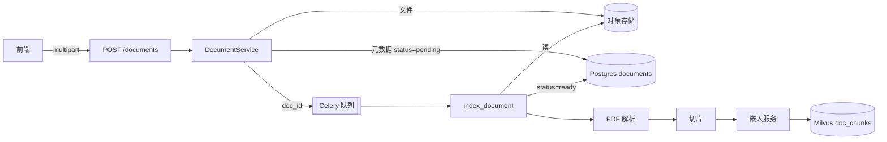

# 示例报告

下面是一份填好的解析报告,用来校准**粒度和篇幅**。注意几个特征:每个结论都带 `文件:行号`;推测处明确标注;第 9、10 章不是凑数,是这份报告最有价值的部分。

代码库是虚构的(一个文档检索应用),但结构对应真实工程中常见的形态。

---

# 文档上传与建索引 实现解析
> 代码版本:`a3f91c2` (2026-08-28) | 深度:完整

## 一句话
用户在前端上传一个 PDF,服务端同步保存文件并落一条 `documents` 记录后立即返回,真正的解析、切片、向量化在 Celery 任务里异步完成,完成后文档状态从 `pending` 变成 `ready`,此时才可被检索。

## 1. 骨架

| 层 | 职责 | 关键文件 |
|---|---|---|
| 路由 | 接收 multipart、鉴权、大小校验 | `api/routes/documents.py` |
| 服务 | 落库、写文件、投递任务 | `services/document.py` |
| 异步任务 | 解析 → 切片 → 嵌入 → 写向量库 | `tasks/indexing.py` |
| 数据访问 | ORM 模型与查询 | `models/document.py`, `repositories/document.py` |
| 外部客户端 | 对象存储、嵌入模型、向量库 | `clients/s3.py`, `clients/embedding.py`, `clients/milvus.py` |

## 2. 入口

| 类型 | 触发方式 | 位置 |
|---|---|---|
| HTTP | `POST /api/v1/documents` | `api/routes/documents.py:34` |
| 异步任务 | Celery `index_document` | `tasks/indexing.py:19` |
| 管理命令 | `python -m cli reindex --doc-id` | `cli/commands.py:77` |

⚠️ 第三个入口容易被漏掉:它**绕过了 HTTP 层的所有校验**直接调 `tasks/indexing.py:19`,任何加在路由层的规则对它无效。

## 3. 主链路

**阶段 A — 同步部分(请求内完成,约 200ms)**

1. `api/routes/documents.py:34` `upload_document()` — 解析 multipart,`Depends(get_current_user)` 已在此前完成鉴权
2. `api/routes/documents.py:41` — 校验扩展名与大小(上限 50MB,硬编码在 `:38`)
3. `services/document.py:52` `DocumentService.create()` — 事务开始
4. `clients/s3.py:28` `upload()` — 写对象存储,key 为 `docs/{tenant_id}/{uuid}.pdf`
5. `repositories/document.py:19` `insert()` — 插入 `documents`,`status='pending'`
6. `services/document.py:71` — **事务提交**
7. `services/document.py:74` `index_document.delay(doc.id)` — 投递 Celery 任务

**阶段 B — 异步部分(队列中执行,分钟级)**

8. `tasks/indexing.py:19` `index_document(doc_id)` — 从 DB 重新加载文档
9. `parsers/pdf.py:44` `extract_text()` — PyMuPDF 逐页抽文本(扫描件不走 OCR,见第 9 章)
10. `chunking/splitter.py:30` `split()` — 按 800 token / 100 overlap 切片
11. `clients/embedding.py:55` `embed_batch()` — 批量 32,调本地推理服务
12. `clients/milvus.py:88` `insert()` — 写入 collection `doc_chunks`
13. `repositories/document.py:46` `update_status()` — 置为 `ready`

## 4. 数据结构

### 核心类型

| 类型 | 定义 | 作用 | 要点 |
|---|---|---|---|
| `DocumentUpload` | `schemas/document.py:14` | 请求体元数据 | `title` 可选,缺省时取文件名 |
| `Document` | `models/document.py:22` | ORM 模型 | `status` 是字符串而非枚举,取值散落在 4 处 |
| `Chunk` | `chunking/splitter.py:12` | 切片(dataclass,不落 DB) | 带 `page_no`,但写 Milvus 时被丢弃 |
| Milvus schema | `clients/milvus.py:31` | 向量记录 | 字段 `doc_id / chunk_idx / text / vector` |
| `DocumentOut` | `schemas/document.py:38` | 响应体 | 不含 `s3_key`,前端拿不到原文链接 |

### 形态变换链

`UploadFile` → (`services/document.py:58` 手工构造) → `Document` ORM
文本 → (`splitter.py:30`) → `list[Chunk]` → (`clients/milvus.py:80` 手工组 dict) → Milvus 行

- ⚠️ `Chunk.page_no` 在 `clients/milvus.py:80` 的字典构造里没有被带上,导致检索结果无法回跳到原文页码。这大概率是个 bug 而非设计取舍 —— `splitter.py:12` 特意算了这个字段。
- ⚠️ Milvus schema 在 `clients/milvus.py:31` 用字典字面量定义,和 `Chunk` dataclass 没有任何编译期/运行期关联,改一边不会报错。

## 5. 数据流

## 6. 状态与外部依赖

- **DB**:`documents`(读写)。`status` 无索引,列表页按 status 过滤会全表扫(`repositories/document.py:60`)。
- **对象存储**:S3 兼容,key 前缀含 `tenant_id`,是唯一的租户隔离手段 —— 没有额外的 bucket policy(推测,基础设施配置不在本仓库)。
- **Milvus**:collection `doc_chunks`,`clients/milvus.py:31`。**没有按租户分 partition**,过滤靠查询时的 `expr`(`clients/milvus.py:112`),漏写 expr 就会跨租户泄露。
- **事务边界**:`services/document.py:52` → `:71`。注意 S3 写入在事务内但不受事务保护,事务回滚会留下孤儿文件,无清理逻辑。
- **幂等性**:`index_document` 不幂等。重跑会向 Milvus 重复插入同一批 chunk(`clients/milvus.py:88` 是 insert 不是 upsert),检索时出现重复结果。Celery 默认重试会直接触发这个问题。

## 7. 分支与异常路径

| 条件 | 走向 | 位置 |
|---|---|---|
| 扩展名不在白名单 | 400 `UnsupportedFileType` | `api/routes/documents.py:41` |
| 超过 50MB | 413 | `api/routes/documents.py:38` |
| S3 写失败 | 事务回滚,500 | `services/document.py:64` |
| PDF 解析异常 | 捕获后置 `status='failed'`,**吞掉异常不重试** | `tasks/indexing.py:35` |
| 嵌入服务超时 | 未捕获 → Celery 默认重试 → 见上面的幂等性问题 | `clients/embedding.py:55` |

## 8. 改动指引

| 你想做的改动 | 该动的地方 | 会波及 |
|---|---|---|
| 支持新文件格式 | `parsers/` 加解析器 + `api/routes/documents.py:41` 白名单 + `tasks/indexing.py:28` 分发 | 三处必须同步,漏一处表现为静默 `failed` |
| 改切片策略 | `chunking/splitter.py:30` | 已有文档不会自动重建,需跑 `cli reindex` |
| 换嵌入模型 | `clients/embedding.py` + Milvus collection 维度 | **向量维度变了必须重建 collection**,老数据不兼容 |
| 加租户隔离 | `clients/milvus.py` partition + 所有查询入口 | 建议在 client 层强制注入 tenant,而不是靠调用方记得传 |

## 9. 可疑点与技术债

1. `Chunk.page_no` 被计算但被丢弃(`clients/milvus.py:80`)—— 功能缺失,修复成本极低。
2. 索引任务不幂等(`clients/milvus.py:88` 用 insert)—— 配合 Celery 重试会静默产生重复数据,建议改 upsert 或写前先按 `doc_id` 删。
3. `status` 用裸字符串,取值散落在 `models/document.py:29`、`tasks/indexing.py:35`、`:52`、`repositories/document.py:46`,拼错不会报错。
4. 扫描件无 OCR 分支,`parsers/pdf.py:44` 抽出空文本后照常走完流程,最终 `status='ready'` 但检索不到任何内容 —— **状态是对的,结果是错的**,这类问题最难排查。
5. `services/document.py:58` 与 `cli/commands.py:81` 有两份几乎相同的文档构造逻辑,已经出现分叉(CLI 版本没设 `tenant_id`)。
6. 事务内做 S3 网络 IO(`services/document.py:60`),慢调用会长时间持有数据库连接。

## 10. 未验证

- Celery 的重试次数与退避策略没在代码里找到,可能在 worker 启动参数或部署配置中(推测)。
- Milvus collection 的索引类型和参数不在本仓库,`clients/milvus.py:31` 只建 schema,索引可能是运维手工建的。
- 前端如何轮询 `status` 没有追踪(不在本次范围)。
- `clients/embedding.py:55` 调用的推理服务的超时与并发上限未确认。
